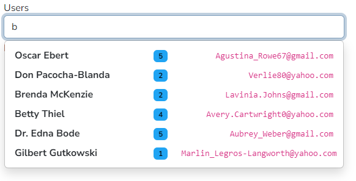
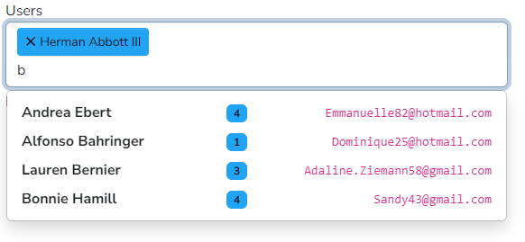
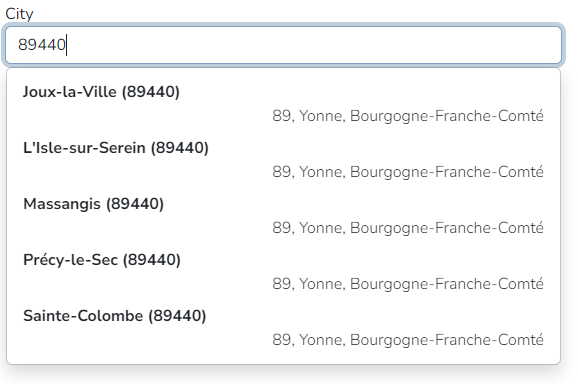
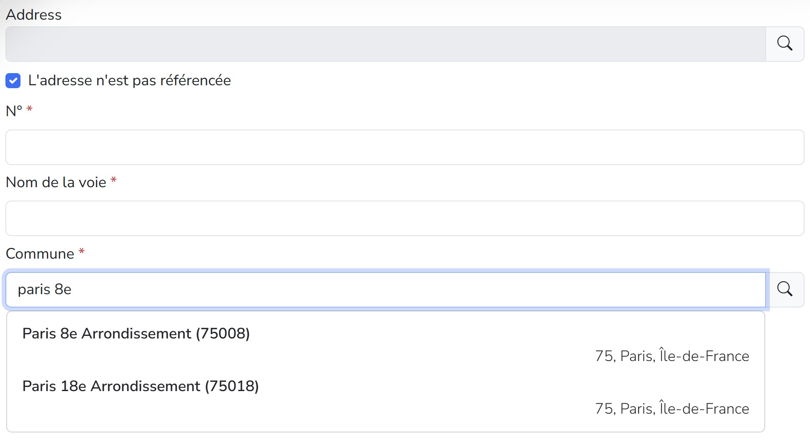

# Auto-complete elements

Dropdown elements querying a **server datasource on the fly** while the user types, well adapted for a **large number
of items**. For a datasource loaded in memory, use the [selection elements](./selects.md) instead.

| Element | Selection | Datasource | API |
|---|---|---|---|
| `auto-complete` | single | your controller | [AutoComplete](../src-elements-auto-complete_auto-complete.md) |
| `badges-auto-complete` | multiple, shown as **badges** | your controller | [BadgesAutoComplete](../src-elements-auto-complete_badges-auto-complete.md) |
| `address-auto-complete` | single address or city | the French [Base Adresse Nationale](https://www.data.gouv.fr/fr/datasets/base-adresse-nationale/) | [AddressAutoComplete](../src-elements-auto-complete_address-auto-complete.md) |

| `auto-complete` | `badges-auto-complete` |
|---|---|
|  |  |

## Usage

`auto-complete` and `badges-auto-complete` get their items from an
[`AutoCompleteController`](../src-elements-auto-complete_auto-complete-controller.md) exposed by your viewmodel.

1. Inject a new instance of the controller in your viewmodel:

   ```javascript
   import { inject, NewInstance } from 'aurelia-framework';
   import { AutoCompleteController } from '@actionlogementservices/aurelia-plugin-ui';

   @inject(NewInstance.of(AutoCompleteController))
   export class ExempleAutoComplete {
     /** @type {AutoCompleteController<any>} */ itemsController;

     /**
      * @param {AutoCompleteController<any>} controller
      */
     constructor(controller) {
       this.itemsController = controller;
     }
   }
   ```

1. Configure it with the search function, see [Controller](#controller).
1. Bind it to the `controller` attribute of the element, and bind the selection: `selected-item` for `auto-complete`,
   `selected-items` (an array) for `badges-auto-complete`.

   ```html
   <auto-complete class="form-control" controller.bind="itemsController" selected-item.bind="selectedItem"></auto-complete>

   <badges-auto-complete class="form-control" controller.bind="itemsController" selected-items.bind="selectedItems"></badges-auto-complete>
   ```

The selection can also be bound by value with `selected-value(s)` and `value-key`: see
[`selected-*` attributes](./selects.md#selection-selected--attributes) for the possible binding combinations.

## Controller

`configure(search, buildItemModel, getItems)` takes up to three functions:

| Parameter | Signature | Role |
|---|---|---|
| `search` | `(text: string) => Promise<T[]>` | Searches the items matching the user input. Required. |
| `buildItemModel` | `(item: T) => U` | Transforms each result into the model displayed by the element. Optional. |
| `getItems` | `(values: K[]) => Promise<T[]>` | Retrieves the items by their values, to display an initial `selected-value(s)` (e.g. an already saved form). Optional. |

```javascript
activate() {
  const searchItems = text => this._service.searchItems(text);
  const buildItemModel = item => {
    if (!item) return;
    const fullName = `${item.firstname} ${item.lastname.toUpperCase()}`;
    return Object.assign(item, { fullName });
  };
  const getItemsByCodes = codes => this._service.getItemsByCodes(codes);
  this.itemsController.configure(searchItems, buildItemModel, getItemsByCodes);
}
```

Pass `undefined` to skip `buildItemModel`: `this.itemsController.configure(searchItems, undefined, getItemsByCodes)`.

## Item template

Both elements accept an optional template for the dropdown items, where `item` is the current item (as built by
`buildItemModel`):

```html
<auto-complete class="form-control" controller.bind="itemsController" selected-item.bind="selectedItem">
  <template replace-part="itemTemplate">
    <p class="fw-semibold my-1">${item.code}</p>
    <p class="my-1">${item.fullName}</p>
  </template>
</auto-complete>
```

## Keyboard and accessibility

Like the [selection elements](./selects.md#keyboard-and-accessibility), both elements follow the WAI-ARIA combobox
pattern: `↓` / `↑` move the active option among the results while the focus stays on the input, `Enter` picks it,
`Escape` closes the list and `Tab` leaves the field. The "no result" line cannot be picked. The badges of
`badges-auto-complete` are removed with a button named "Retirer <label>", after which the focus goes back to the input.

## In a form

Place `auto-complete` in an [`als-field`](./forms.md#als-field) and bind the selection with `& validate`. The label
is linked to the search input, and the selection is validated when the user leaves the field, like a native input.

```html
<als-field label="Ville" required="true">
  <auto-complete
    class="form-control"
    controller.bind="citiesController"
    label-key="name"
    value-key="code"
    selected-value.bind="model.city & validate"></auto-complete>
</als-field>
```

## Attributes

| Attribute | Role | Possible values | Default value | Elements |
|---|---|---|---|---|
| `controller` | Controller querying the items, see [Controller](#controller) | `AutoCompleteController` instance | | both |
| `selected-item` / `selected-value` | Single selection, see [`selected-*` attributes](./selects.md#selection-selected--attributes) | Item / value of its `value-key` property | | `auto-complete` |
| `selected-items` / `selected-values` | Multiple selection, see [`selected-*` attributes](./selects.md#selection-selected--attributes) | Array of items / of values | `[]` | `badges-auto-complete` |
| `value-key` | Property of the item used to differentiate them | Any string representing a property present on the item | `name` | both |
| `label-key` | Property of the item used to display them in the dropdown | Any string representing a property present on the item | `description` | both |
| `placeholder` | Placeholder in the select when no selection is done | Any string | | both |
| `disabled` | Disable the user interaction | `true` or `false` | `false` | both |
| `autosize` | Autosize the dropdown width to the parent width rather than the content of the dropdown | `true` or `false` | `true` | both |
| `no-result-text` | Text displayed when the query returns no item | Any string | `Aucun résultat` | both |
| `delay` | Throttling delay in ms before requesting data | Any number > 0 | `700` | both |

## `address-auto-complete`

Selects an address, or a city, from the French **Base Adresse Nationale** (BAN) api. It does not need a controller, but
requires the `aurelia-validation`, `aurelia-configuration` and `aurelia-fetch-client` peer dependencies, and a
`config.json` file with the url of the BAN api:

```json
{
  "api": {
    "address": "https://your_ban_api_instance_address"
  }
}
```

Bind the `value` attribute to retrieve the selected address, an
[`Adresse`](../src-elements-auto-complete_adresse.md) instance:

```html
<address-auto-complete value.bind="selectedAddress"></address-auto-complete>
```



With `manual-entry="true"`, the user can fill the address manually when it is not found:

```html
<address-auto-complete value.bind="selectedAddress" manual-entry="true"></address-auto-complete>
```



| Attribute | Role | Possible values | Default value |
|---|---|---|---|
| `value` | Selected address (two-way) | `Adresse` | |
| `mode` | Query mode of the BAN api | `address` to get a full address, `zipCode` to get only a city | `address` |
| `manual-entry` | Allow the user to fill the address manually if not found. Works only with `mode="address"` | `true` or `false` | `false` |
| `show-icon` | Displays a search icon next to the input | `true` or `false` | `true` |
| `placeholder` | Placeholder in the select when no selection is done | Any string | |
| `disabled` | Disable the user interaction | `true` or `false` | `false` |
| `autosize` | Autosize the dropdown width to the parent width rather than the content of the dropdown | `true` or `false` | `false` |
