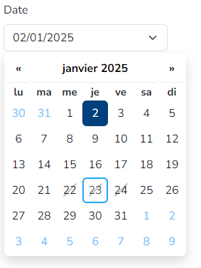
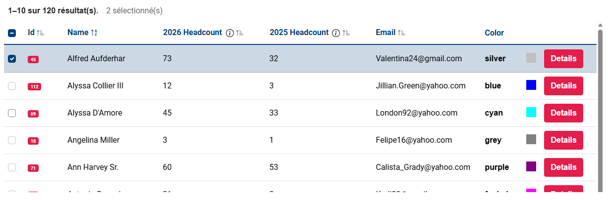
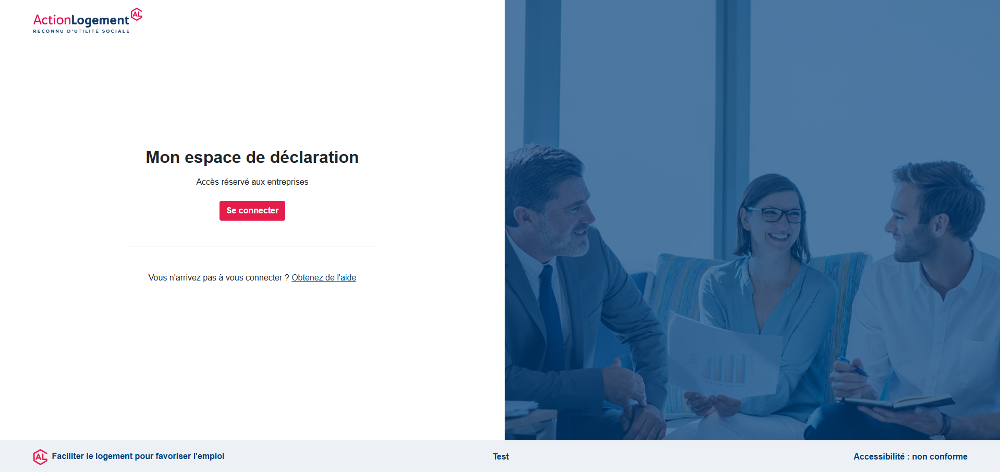

# Other components

| Component | Role | API |
|---|---|---|
| **Dates** | | |
| [`input-datepicker`](#input-datepicker) | Date input with a calendar dropdown | [InputDatepicker](../src-elements-input-datepicker_input-datepicker.md) |
| [`dateFormat`](#dateformat-value-converter) | Value converter formatting a date | [DateFormatValueConverter](../src-value-converters_date-format.md) |
| **Numbers** | | |
| [`input-mask`](#input-mask-custom-attribute) | Custom attribute masking a number input | [InputMaskCustomAttribute](../src-attributes_input-mask.md) |
| [`numberFormat`, `cleanInputMask`](#numberformat-and-cleaninputmask-value-converters) | Value converters formatting and parsing masked numbers | [NumberFormat](../src-value-converters_number-format.md), [CleanInputMask](../src-value-converters_clean-input-mask.md) |
| **Table** | | |
| [`simple-table`](#simple-table) | Table with column templates, sorting, selection and pagination | [SimpleTable](../src-elements-simple-table_simple-table.md), [Column](../src-elements-simple-table_column.md) |
| **Page layout** | | |
| [`als-pre-login`](#als-pre-login) | Landing page before authentication | [AlsPreLogin](../src-layouts-als-pre-login_als-pre-login.md) |
| [`als-footer`](#als-footer) | Action Logement footer | [AlsFooter](../src-elements-als-footer_als-footer.md) |
| [`als-user-menu`](#als-user-menu) | User initials and account actions menu | [AlsUserMenu](../src-elements-als-user-menu_als-user-menu.md) |
| [`breadcrumbs`](#breadcrumbs) | Breadcrumbs of the current route | [Breadcrumbs](../src-elements-breadcrumbs_breadcrumbs.md) |
| [`environment-ribbon`](#environment-ribbon) | Ribbon displaying the current environment | [EnvironmentRibbon](../src-elements-environment-ribbon_environment-ribbon.md) |
| [`loading-indicator`](#loading-indicator) | Progress bar displayed while loading | [LoadingIndicator](../src-elements-loading-indicator_loading-indicator.md) |
| **Utilities** | | |
| [`als-dropdown`](#als-dropdown) | Generic Bootstrap dropdown | [AlsDropdown](../src-elements-als-dropdown_als-dropdown.md) |
| [`no-submit`](#no-submit-custom-attribute) | Custom attribute preventing a form submission | [NoSubmitCustomAttribute](../src-attributes_no-submit.md) |
| [`als-gtag`](#als-gtag) | Google Tag Manager script | [AlsGtag](../src-elements-als-gtag_als-gtag.md) |

The `<lock>` element is described with the [`LockService`](./services.md#lockservice). In a form, prefer the
[`als-datepicker`](./forms.md#als-datepicker) field and the [`formInputNumberFormat`](./forms.md#numbers-forminputnumberformat-value-converter)
converter.

## Dates

### `input-datepicker`

Calendar dropdown based on [vanilla-js datepicker](https://mymth.github.io/vanillajs-datepicker/#/), selecting a single
date bound to `date`.



```html
<input-datepicker date.bind="date"></input-datepicker>
```

| Attribute | Role | Possible values | Default value |
|---|---|---|---|
| `date` | Selected date | Calendar date `YYYY-MM-DD` (an ISO date time is also read) | |
| `placeholder` | Placeholder displayed when no date is selected | Any string | |
| `disabled` | Disable the user interaction | `true` or `false` | `false` |
| `readonly` | Readonly field | `true` or `false` | `false` |
| `autohide` | Hides the calendar after a selection | `true` or `false` | `true` |
| `disabled-days` | Days of week to disable | Array of numbers, 0 for Sunday, 1 for Monday, and so on | `[]` |
| `disabled-dates` | Specific dates to disable | Array of calendar dates `YYYY-MM-DD` | `[]` |
| `min-date` | All the dates before this date are disabled | Calendar date `YYYY-MM-DD` | |
| `max-date` | All the dates after this date are disabled | Calendar date `YYYY-MM-DD` | |

### `dateFormat` value converter

Displays a date (calendar date `YYYY-MM-DD`, ISO date time or `Date`) in the French format `DD/MM/YYYY`, or in
`YYYY-MM-DD` or `MM/DD/YYYY`. From the view, it parses a date typed in this format into a calendar date `YYYY-MM-DD`.

The dates of the plugin are calendar dates `YYYY-MM-DD`, without time nor time zone: the 15th of March is
`2024-03-15` for every user, whatever their time zone. The French format is only used to display them. Build them
with `toCalendarDate(date)` and read them with `parseCalendarDate(value)`, exported by the plugin:

```javascript
import { parseCalendarDate, toCalendarDate } from '@actionlogementservices/aurelia-plugin-ui';

minDate = toCalendarDate(new Date()); // today, e.g. '2026-11-25'
const date = parseCalendarDate('2026-11-25'); // local midnight of this day
```

```html
<span>${contract.startDate | dateFormat}</span>
<span>${contract.startDate | dateFormat:'YYYY-MM-DD'}</span>
```

## Numbers

### `input-mask` custom attribute

Masks a number input with the [inputmask](https://www.npmjs.com/package/inputmask) package: French digit grouping
(`1 234,5`), no negative numbers.

| Value | Decimals |
|---|---|
| `integer` | 0 |
| `decimal` | 2 |
| `currency` | 0 |
| `percentage` | 1, between 0 and 100 |

### `numberFormat` and `cleanInputMask` value converters

`numberFormat` formats a number for the view, and `cleanInputMask` parses the masked text back to a number. Bind them
separately, one way each:

```html
<input
  type="text"
  input-mask="currency"
  value.one-time="amount | numberFormat"
  value.from-view="amount | cleanInputMask" />
```

`numberFormat` accepts the options `{ locale, digits, suffix }`, by default `{ locale: 'fr-FR', digits: 2, suffix: '' }`:
`${amount | numberFormat:{ digits: 0, suffix: ' €' }}`. `0` is displayed (`0,00`), an empty or non numeric value is
not. A field that must stay empty until the user fills it is bound to an `undefined` value: convert the default `0` of
the api in the application when loading the data, not in the view.

In a form validated with aurelia-validation, use [`formInputNumberFormat`](./forms.md#numbers-forminputnumberformat-value-converter)
instead: it formats and parses in a single two-way binding.

## `simple-table`

Scrollable table with **column templates**, **in-memory sorting**, row **selection** and optional **pagination**, well
adapted for a small number of items (typically **less than 100**) or a paginated datasource.



Bind the items to `datasource`, and declare the columns with `<column>` elements: `cell-key` names the displayed
property, and the content of the element, where `item` is the current row, replaces the default cell content.

```html
<simple-table
  parent-ref.bind="$this"
  datasource.bind="itemsList"
  selected-items.bind="selectedItems"
  selection-mode="multiple"
  value-key="id">
  <column header="Id" cell-key="id" sortable="true" sort-type="numeric" width="80px">
    <span class="badge text-bg-secondary">${item.id}</span>
  </column>
  <column header="Nom" cell-key="name" sortable="true"></column>
  <column cell-key="headcount" sortable="true" sort-type="numeric">
    <template replace-part="header">Effectif ${metadata.currentYear}</template>
    ${item.headcount}
  </column>
  <column>
    <button class="btn btn-secondary" click.trigger="parentRef.showItemDetails(item)">Détails</button>
  </column>
</simple-table>
```

In a column template, `parentRef` is the viewmodel bound to `parent-ref`, and `metadata` the value bound to `metadata`.

### Search

With `searchable="true"`, a search field is displayed above the table. The searched text is the two-way `search`
attribute, which the application can also bind to its own field instead of `searchable`.

- An array `datasource` is filtered on the `cell-key` of the columns, the text being searched without case nor accents
  ("eleve" finds "Élève"). A column without `cell-key` is not searched; when a template displays another value than
  the raw one (e.g. a formatted date), give the rule with `search-filter`: a `(item, search) => boolean` function.
- With a `{ items, totalCount }` `datasource`, the table does not filter the page: bind `search` and reload, like the
  sort. The typed text is debounced (300 ms).
- A new search restarts from the first page. The row count of the detail bar, announced by the screen readers, counts
  the results, and the empty table tells the searched text ("Aucun résultat pour « xxx »"), also announced.
- The selection is kept while the search hides rows: "Effacer la sélection" is then offered, and "Sélectionner les N
  résultats" adds the results of the search to the selection.

```html
<simple-table datasource.bind="contracts" searchable="true" search.bind="searchedText">
```

### Title and loading

Give the table a title with `caption`: it is displayed above the table and names it for the screen readers
(`aria-labelledby`, RGAA criterion 5.4). When a visible heading of the page already titles the table, set
`hide-caption="true"`: the caption only names the table (`aria-label`).

While the parent loads the rows (a page, a sort...), bind `loading`: the table is busy (`aria-busy`), dimmed and out of
reach of the mouse, and the detail bar displays "Chargement en cours", announced by the screen readers. The controls
are not disabled, so that they keep the keyboard focus.

```html
<simple-table caption="Contrats en cours" datasource.bind="pageResult" loading.bind="isLoading" ...>
```

### Detail bar

Above the table, aligned with the content of the cells, a bar displays the row count (the range of the page when the
rows are on several pages, e.g. `11–20 sur 120 résultat(s).`), the number of selected rows, and a warning when not all the rows are
displayed. The row count is a status, announced by the screen readers when it changes. Hide the bar with
`no-row-count-header="true"`.

### Selection and accessibility

With `selection-mode="single"` or `"multiple"`, each row starts with a checkbox named "Sélectionner la ligne <n>",
reachable with `Tab` and toggled with `Space`; a click elsewhere on the row also toggles it, except on a control of a
cell (link, button, input). In `multiple` mode, the "Tout sélectionner" checkbox of the header selects every enabled
row of the displayed page, and is mixed when only a part of them is selected; the selection of the other pages is
kept. The selection is identified by `value-key`: it survives the page changes, even when the parent reloads the page.
The table emits a `change` event whose `detail` is the selection.

Once the rows of the page are all selected, the detail bar offers to select the rows of every page ("Sélectionner les
120 résultats", with an array `datasource` only: the other pages of a `{ items, totalCount }` one are not loaded), and
a selection going beyond the page can be cleared at once ("Effacer la sélection"). As the button appears before the
table, above the focused checkbox, the screen readers announce it.

The header of the sorted column carries `aria-sort` (`ascending` or `descending`): the screen readers tell the sort
order, which the icon only shows.

### Pagination

Set `paginated="true"`: a page size selector (`10`, `20`, `50` or `100`) is displayed next to the pagination.

- With an array `datasource`, pagination and sorting are done in memory on the whole array.
- With a `{ items, totalCount }` `datasource` (`pageResult` below), the parent loads the requested page itself: bind
  `page`, `max-rows` and `sort` to viewmodel properties and reload on their change. A sort chosen by the user restarts
  from the first page; the displayed page is sorted in memory until the parent reloads it.

```html
<simple-table
  datasource.bind="pageResult"
  paginated="true"
  page.bind="page"
  max-rows.bind="pageSize"
  sort.bind="sort">
  ...
</simple-table>
```

```javascript
// sort: { key: 'name', order: 'asc' }, key being the cell-key of the sorted column
async load() {
  this.pageResult = await this.api.search({ page: this.page, size: this.pageSize, sort: this.sort });
}
```

### Sorting

A click on the header of a `sortable` column sorts the rows by its `cell-key`, ascending then descending. An array
`datasource` is sorted as a whole, beyond the displayed rows and pages. The sort is the two-way `sort` attribute
(`{ key, order }`), initialized from the `sort-order` of a column.

### Tooltips

- When a cell is too small to render its content (an ellipsis is shown), a Bootstrap tooltip is created on it.
- A Bootstrap tooltip is also created on the elements of a column template with `data-bs-*` attributes. Always give a
  non empty title, to avoid a Bootstrap error:

  ```html
  <column header="Id" cell-key="id">
    <span data-bs-toggle="tooltip" data-bs-title="${item && item.name ? item.name : ' '}">${item.id}</span>
  </column>
  ```

### Attributes

| `simple-table` attribute | Role | Possible values | Default value |
|---|---|---|---|
| `datasource` | Items to display | Array of objects, or `{ items, totalCount }` when paginated by the parent | |
| `value-key` | Property of the item used to differentiate them | Any string representing a property present on the item | `name` |
| `selection-mode` | Selection mode | `none`, `single` or `multiple` | `none` |
| `selected-items` | Selected items, identified by `value-key` (the items themselves are not modified) | Array of objects | `[]` |
| `sort` | Sort of the rows (two-way): the `cell-key` of the sorted column and the order | `{ key, order }`, `order` being `asc` or `desc` | the `sort-order` of a column |
| `disabled` | Disables the user interaction: selection, sorting and page size | `true` or `false` | `false` |
| `disableable-rows` | Allows disabling rows individually | `true` or `false` | `false` |
| `disable-prop-name` | Property of the item telling that its row is disabled | Any string | `disabled` |
| `max-rows` | Maximal number of displayed rows, the page size when paginated (two-way binding) | Any number > 0 | `50`, `10` when paginated |
| `paginated` | Enables the pagination | `true` or `false` | `false` |
| `page` | Current page, 1-based (two-way binding) | Any number > 0 | `1` |
| `page-size-text` | Label of the page size selector | Any string | `Éléments par page` |
| `page-sizes` | Page sizes offered by the page size selector | Array of numbers | `[10, 20, 50, 100]` |
| `searchable` | Displays the search field | `true` or `false` | `false` |
| `search` | Searched text (two-way) | Any string | |
| `search-filter` | Search rule of an array datasource, instead of the `cell-key` of the columns | `(item, search) => boolean` | |
| `search-label` | Label of the search field | Any string | `Rechercher dans le tableau` |
| `no-search-result-text` | Text of the empty table after a search. The `{search}` token is replaced by the searched text | Any string | `Aucun résultat pour « {search} »` |
| `caption` | Title of the table, displayed above it and naming it | Any string | |
| `hide-caption` | Hides the caption, which still names the table | `true` or `false` | `false` |
| `loading` | The parent loads the rows: the table is busy and tells the wait | `true` or `false` | `false` |
| `loading-text` | Text of the detail bar while loading | Any string | `Chargement en cours` |
| `max-height` | CSS max height of the table | Any CSS height | `500px` |
| `fixed-row-height` | Fixed row height. When `false`, the text wraps and the rows may have different heights | `true` or `false` | `true` |
| `no-row-count-header` | Hides the detail bar above the table: row count, selection count and warning | `true` or `false` | `false` |
| `no-result-text` | Text displayed when there is no item | Any string | `Aucun résultat` |
| `result-text` | Text displayed after the number of items | Any string | `résultat(s).` |
| `selected-text` | Text displayed after the number of selected items | Any string | `sélectionné(s)` |
| `select-all-text` | Button selecting the rows of every page. Must contain the `{count}` token | Any string with `{count}` | `Sélectionner les {count} résultats` |
| `select-all-selectable-text` | Button selecting the rows of every page when some rows are disabled. Must contain the `{count}` token | Any string with `{count}` | `Sélectionner les {count} résultats sélectionnables` |
| `clear-selection-text` | Button clearing a selection going beyond the page | Any string | `Effacer la sélection` |
| `select-page-text` | Accessible name of the checkbox selecting the rows of the page | Any string | `Tout sélectionner` |
| `select-row-text` | Accessible name of the checkbox of a row. The `{row}` token is replaced by its number in the page | Any string | `Sélectionner la ligne {row}` |
| `select-all-hint-text` | Announced when the button selecting every page appears. The `{button}` token is replaced by its text | Any string | `Toutes les lignes de la page sont sélectionnées. Bouton « {button} » disponible au-dessus du tableau.` |
| `warning-template-text` | Warning displayed when not all the items are displayed. Must contain the `{maxRows}` token | Any string with `{maxRows}` | `Seuls les {maxRows} premiers résultats sont affichés.` |
| `metadata` | Extra data available in the column templates | Any | |
| `parent-ref` | Viewmodel available in the column templates as `parentRef` | Any object | |

| `column` attribute | Role | Possible values | Default value |
|---|---|---|---|
| `header` | Header of the column. Use `<template replace-part="header">` for an HTML header | Any string | |
| `cell-key` | Property of the item displayed in the cell, and used for sorting | Any string representing a property present on the item | |
| `sortable` | Is the column sortable | `true` or `false` | `false` |
| `sort-order` | Initial sorting order of the table by this column, then reflects the `sort` of the table | `asc` or `desc` | |
| `sort-type` | Sorting type | `text` or `numeric` | `text` |
| `width` | CSS width of the column | Any CSS width | `auto` |

## Page layout

### `als-pre-login`

Landing page displayed before authentication, with a login button, a help link and an [`als-footer`](#als-footer).
Its `title` is the `h1` of the page, and the logo an image named "Action Logement"; the side image (`img-path`) is
decorative.



```html
<als-pre-login
  help-url="https://aide.example.com"
  footer-links.bind="footerLinks"
  on-connect-button-click.call="goToLogin()"></als-pre-login>
```

```javascript
export class LoginPage {
  footerLinks = [
    { text: 'Mentions légales', url: 'https://example.com/mentions-legales' },
    { text: 'CGU', url: 'https://example.com/cgu' }
  ];

  goToLogin() {
    // navigates to the login page or opens the authentication flow
  }
}
```

| Attribute | Role | Possible values | Default value |
|---|---|---|---|
| `title` | Main title of the pre-login panel | Any string | `Mon Espace de Déclaration` |
| `subtitle` | Subtitle displayed below the title | Any string | `Accès réservé aux entreprises` |
| `img-path` | Image displayed in the panel, none when empty | Any image URL | `''` |
| `help-url` | URL of the help link displayed under the login button | Any URL | `#` |
| `footer-links` | Links of the footer | Array of `{ text, url }` | |
| `footer-type` | Footer variant | `compact` or `default` | `compact` |
| `on-connect-button-click` | Called when the login button is clicked | Function (`.call` binding) | |

### `als-footer`

Action Logement footer, with the logo, a list of links, the accessibility conformity link and the social media links.

```html
<als-footer links.bind="footerLinks"></als-footer>
```

The attributes are read once (`one-time` binding):

| Attribute | Role | Possible values | Default value |
|---|---|---|---|
| `links` | Links of the footer | Array of `{ text, url }` | `[]` |
| `type` | Footer variant | `default` or `compact` | `default` |
| `logo-url` | URL of the logo link | Any URL | `https://www.actionlogement.fr/entreprise` |
| `accessibility-text` | Text of the accessibility conformity link | Any string | `Accessibilité : non conforme` |
| `accessibility-url` | URL of the accessibility conformity link | Any URL | `https://www.actionlogement.fr/schema-pluriannuel-accessibilite-numerique` |
| `hide-social-media-links` | Hides the social media links | `true` or `false` | `false` |
| `youtube-url`, `twitter-url`, `linkedin-url` | URLs of the social media pages | Any URL | Action Logement pages |

### `als-user-menu`

User initials in an avatar, opening a menu of account actions. Each item is a link when `href` is set, otherwise a
button calling its `click` function (activated by `Enter` and `Space`). The keyboard is the one of
[`als-dropdown`](#als-dropdown).

```html
<als-user-menu initials="UA" items.bind="userMenuItems"></als-user-menu>
```

```javascript
userMenuItems = [
  { label: 'Mes informations', icon: 'bi-person', href: '#/profil' },
  { label: 'Déconnexion', icon: 'bi-x-circle', click: () => this.auth.logout() }
];
```

| Attribute | Role | Possible values | Default value |
|---|---|---|---|
| `initials` | Initials displayed in the avatar | Any string | `''` |
| `label` | Label displayed below the avatar | Any string | `Mon compte` |
| `items` | Menu items, `icon` being a bootstrap-icons class | Array of `{ label, icon?, href?, click? }` | `[]` |

### `breadcrumbs`

Breadcrumbs of the current route of the root Aurelia router: an `Accueil` link to the root, then a step per route
having a `title`, except the default route (`''`). The last step is the current page (`aria-current="page"`), the
other ones are links to their route, which must have a `name`. The navigation is named "Fil d'Ariane", and the
loading icon displayed while the router navigates is read "Chargement en cours". It has no attribute.

```html
<breadcrumbs></breadcrumbs>
```

### `environment-ribbon`

Ribbon displaying the name of the current environment in a corner of the page, colored by the environment type. Hide
it in production:

```html
<environment-ribbon
  if.bind="environment.type !== 'prod'"
  environment.one-time="environment"
  position="top-left"></environment-ribbon>
```

```javascript
environment = { name: 'RECETTE', type: 'recette' };
```

| Attribute | Role | Possible values | Default value |
|---|---|---|---|
| `environment` | Environment to display; without it, nothing is displayed | `{ name, type }`, `type` being `dev`, `recette`, `preprod` or `prod` | |
| `position` | Corner of the ribbon | `top-left`, `top-right`, `bottom-left` or `bottom-right` | `top-left` |

### `loading-indicator`

Striped progress bar displayed while `loading` is `true`, e.g. during api calls. It is an indeterminate progress bar
(no value) named "Chargement en cours".

```html
<loading-indicator loading.bind="api.isRequesting"></loading-indicator>
```

## Utilities

### `als-dropdown`

Generic Bootstrap dropdown, used by `als-user-menu` and `als-multi-select`. Its content is projected into the menu
(a `<ul class="dropdown-menu">`), and the content of a `slot="toggle"` element into the toggle button. Each projected
element that is not a `<li>` is wrapped in one: a `<li class="dropdown-item">`, or a plain `<li>` for a Bootstrap
element such as a `<hr class="dropdown-divider">`.

| Key | Effect |
|---|---|
| `↓` / `↑` on the toggle button | Opens the menu on its first / last control |
| `↓` / `↑` in the menu | Moves the focus to the next / previous control (link, button, checkbox...), from the last one to the first one, and back |
| `Home` / `End` in the menu | Moves the focus to the first / last control |
| `Escape` | Closes the menu, the focus going back to the toggle button |
| `Tab` | Moves through the controls of the menu, then leaves it |

```html
<als-dropdown label="Actions" menu-class="dropdown-menu-end">
  <li><a class="dropdown-item" href="#/export">Exporter</a></li>
  <li><button type="button" class="dropdown-item" click.trigger="print()">Imprimer</button></li>
</als-dropdown>
```

| Attribute | Role | Possible values | Default value |
|---|---|---|---|
| `label` | Text of the toggle button, when no `toggle` slot is provided | Any string | `''` |
| `disabled` | Disables the toggle button | `true` or `false` | `false` |
| `autosize` | Sizes the dropdown to the width of its parent | `true` or `false` | `false` |
| `auto-close` | Bootstrap `autoClose` option | `true`, `false`, `inside` or `outside` | `true` |
| `toggle-class` | CSS classes of the toggle button | Any string | `''` |
| `menu-class` | CSS classes of the menu | Any string | `''` |
| `aria-label` | Accessible name of the toggle button, overriding its content | Any string | |
| `aria-describedby`, `aria-invalid` | Applied to the toggle button, e.g. to link an error message | Ids / `true` or `false` | |
| `menu-aria-label` | Accessible name of the menu (a list), named by the toggle button otherwise | Any string | |
| `on-focus`, `on-blur` | Called when the toggle button gets or loses the focus | Function receiving the `FocusEvent` | |

### `no-submit` custom attribute

Prevents a `<form>` from being submitted, e.g. by the Enter key in one of its inputs. Handle the actions with
`click.trigger` on the buttons instead.

```html
<form no-submit>
  ...
  <button type="button" class="btn btn-primary" click.trigger="save()">Enregistrer</button>
</form>
```

### `als-gtag`

Injects the Google Tag Manager script and its `noscript` iframe fallback. Use it once, near the root of the application
(e.g. in `app.html`): each instance adds another script and iframe.

```html
<als-gtag tag-id="GTM-ABC1234"></als-gtag>
```

| Attribute | Role | Possible values | Default value |
|---|---|---|---|
| `tag-id` | Google Tag Manager container identifier | Any string | `GTM-XXXXXX` |
