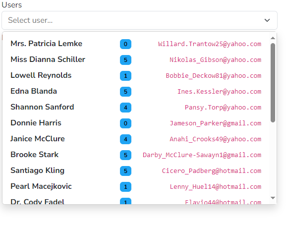
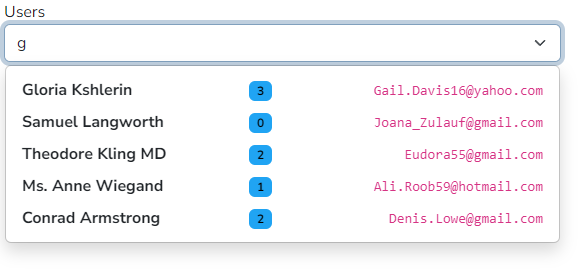
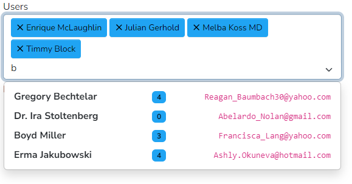

# Selection elements

Dropdown elements selecting items from an **in-memory datasource** (an array loaded in your viewmodel).
For a server datasource queried on the fly, use the auto-complete elements instead.

| Element | Selection | Filtered by user input | Typical number of items | API |
|---|---|---|---|---|
| `simple-select` | single | no | less than 50 | [SimpleSelect](../src-elements-select_simple-select.md) |
| `filterable-select` | single | yes | less than 100 | [FilterableSelect](../src-elements-select_filterable-select.md) |
| `badges-select` | multiple, shown as **badges** | yes | less than 100 | [BadgesSelect](../src-elements-select_badges-select.md) |

| `simple-select` | `filterable-select` | `badges-select` |
|---|---|---|
|  |  |  |

## Usage

1. Prepare a datasource in your viewmodel: an array of items.
1. Bind it to the `datasource` attribute of the element.
1. Bind the selection: `selected-item` for the single selection elements, `selected-items` (an array) for `badges-select`.

```html
<simple-select class="form-select" datasource.bind="itemsList" selected-item.bind="selectedItem"></simple-select>

<filterable-select class="form-select" datasource.bind="itemsList" selected-item.bind="selectedItem"></filterable-select>

<badges-select class="form-select" datasource.bind="itemsList" selected-items.bind="selectedItems"></badges-select>
```

## Item template

Each element accepts an optional template for the dropdown items, where `item` is the current item:

```html
<filterable-select class="form-select" datasource.bind="itemsList" selected-item.bind="selectedItem">
  <template replace-part="itemTemplate">
    <p class="fw-semibold my-1">${item.code}</p>
    <p class="my-1">${item.name}</p>
  </template>
</filterable-select>
```

## Keyboard and accessibility

The elements follow the [WAI-ARIA combobox pattern](https://www.w3.org/WAI/ARIA/apg/patterns/combobox/): the input is
a `combobox` controlling a `listbox` of `option`s, and the focus stays on the input while the keyboard moves the active
option (`aria-activedescendant`), which shows the focus ring.

| Key | Effect |
|---|---|
| `↓` / `↑` | Opens the list and moves the active option (from the last one to the first one, and back) |
| `Enter` | Picks the active option; opens the list of `simple-select` |
| `Space` | `simple-select` only: opens the list or picks the active option |
| `Escape` | Closes the list (an enclosing dialog stays open) |
| `Tab` | Closes the list and leaves the field |

The focus stays on the input after picking a value. The badges of `badges-select` are removed with a button named
"Retirer <label>", after which the focus goes back to the input. Give the element an accessible name, e.g. with an
[`als-field`](./forms.md#als-field) label: the listbox is named like the field, by its label or its `aria-label`.

## Selection: `selected-*` attributes

The selection elements (these ones and the auto-complete elements) expose the user selection in two complementary
forms, kept in sync by the element:

| Element | Selection | Item(s) attribute | Value(s) attribute | Items source |
|---|---|---|---|---|
| `simple-select` | single | `selected-item` | `selected-value` | `datasource` (in memory) |
| `filterable-select` | single | `selected-item` | `selected-value` | `datasource` (in memory) |
| `badges-select` | multiple | `selected-items` | `selected-values` | `datasource` (in memory) |
| `auto-complete` | single | `selected-item` | `selected-value` | `controller` (on the fly) |
| `badges-auto-complete` | multiple | `selected-items` | `selected-values` | `controller` (on the fly) |

- `selected-item(s)` holds the selected item(s) themselves (objects of the datasource or returned by the controller).
- `selected-value(s)` holds the `value-key` property of the selected item(s) (e.g. an id or a code). Set `value-key` accordingly.
- Both attributes are two-way by default. Choose the binding that fits your viewmodel:

  | Scenario | Binding | When to use it |
  |---|---|---|
  | Value only | `selected-value.bind="model.countryId"` | Your model stores the key (most common: it is what you save). |
  | Item only | `selected-item.bind="country"` | Your model stores the whole object. |
  | Value + item (recommended when you need both) | `selected-value.bind="model.countryId"` `selected-item.from-view="country"` | Your model stores the key, and you also need the full selected object (to display other properties, etc.). |
  | Both two-way | `selected-value.bind="..."` `selected-item.bind="..."` | Supported, the element keeps both consistent whichever side changes. |

  ```html
  <simple-select
    class="form-select"
    datasource.bind="countries"
    value-key="id"
    label-key="name"
    selected-value.bind="model.countryId"
    selected-item.from-view="selectedCountry"></simple-select>
  ```

- How a value is resolved into an item:
  - in-memory elements look for the item whose `value-key` property strictly equals (`===`) the value in the `datasource`. The datasource can be loaded after the value: the value is resolved as soon as the datasource is available.
  - controller elements call the controller `getItems` function (see the `configure` method of the controller). The controller can be bound after the value. When the value changes again before the answer arrives, the outdated answer is ignored. Clearing the value does not call `getItems`.
- A value that can't be resolved (not in the datasource, not found by the controller, or controller without `getItems`) **is kept** in your viewmodel: the element simply displays no selection for it.
- For multiple selections, items are displayed in the order of `selected-values`.
- Always **assign a new array** to `selected-values`/`selected-items` (e.g. `this.selectedValues = [...this.selectedValues, id]`): in place mutations like `push` are not detected.

## Attributes

| Attribute | Role | Possible values | Default value | Elements |
|---|---|---|---|---|
| `datasource` | Items to select from | Array of objects | | all |
| `selected-item` / `selected-value` | Single selection, see [above](#selection-selected--attributes) | Item / value of its `value-key` property | | `simple-select`, `filterable-select` |
| `selected-items` / `selected-values` | Multiple selection, see [above](#selection-selected--attributes) | Array of items / of values | `[]` | `badges-select` |
| `value-key` | Property of the item used to differentiate them | Any string representing a property present on the item | `name` | all |
| `label-key` | Property of the item used to display them in the dropdown | Any string representing a property present on the item | `description` | all |
| `placeholder` | Placeholder in the select when no selection is done | Any string | | all |
| `disabled` | Disable the user interaction | `true` or `false` | `false` | all |
| `autosize` | Autosize the dropdown width to the parent width rather than the content of the dropdown | `true` or `false` | `true` | all |
| `clear-selection-text` | Text displayed in the dropdown to clear the selection | Any string | `Effacer la sélection` | `simple-select`, `filterable-select` |
| `no-result-text` | Text displayed when user input filters out all items | Any string | `Aucun résultat` | `filterable-select`, `badges-select` |
